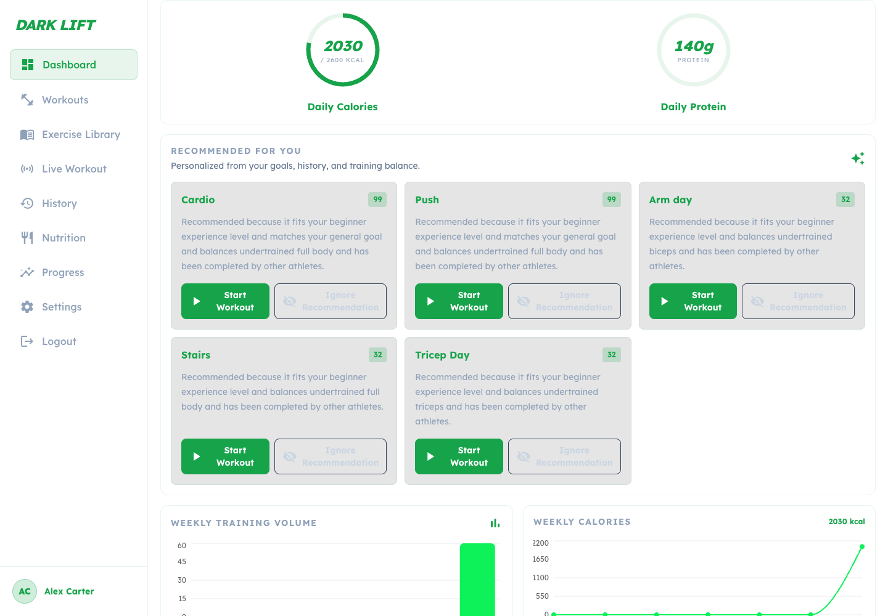
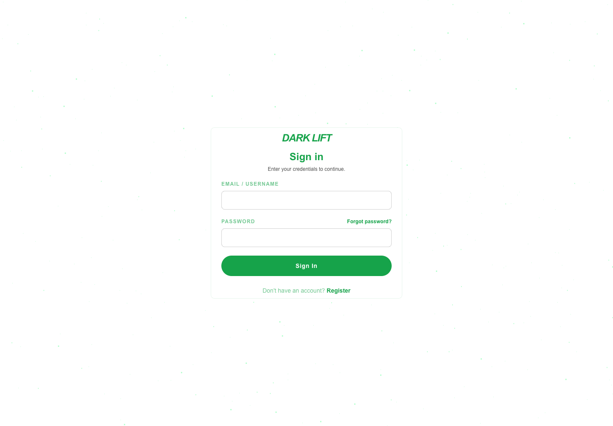
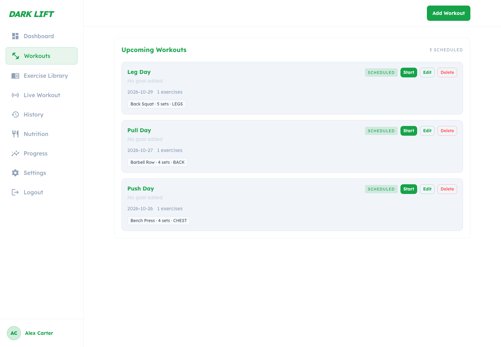
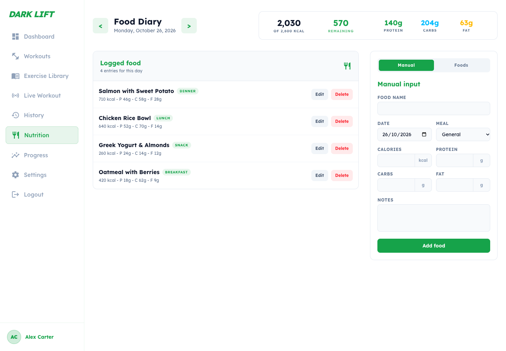
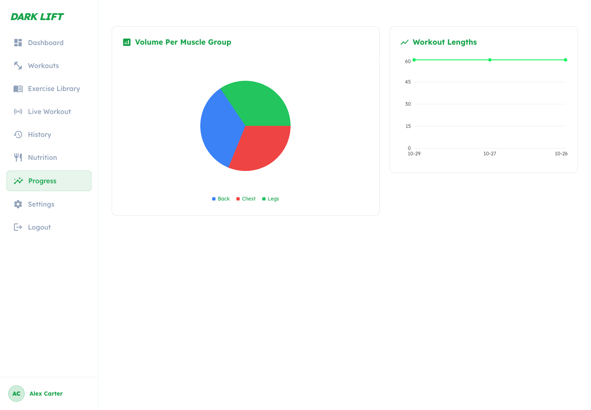
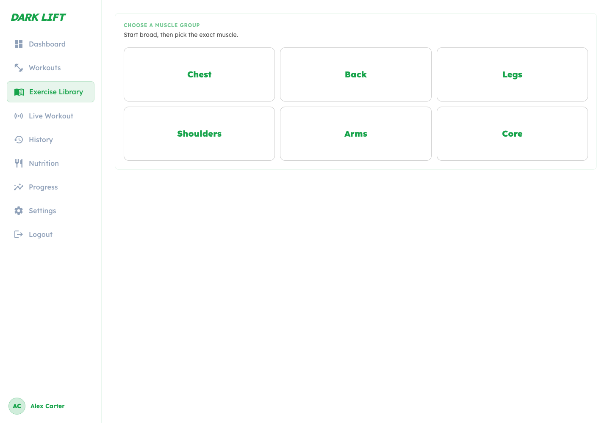
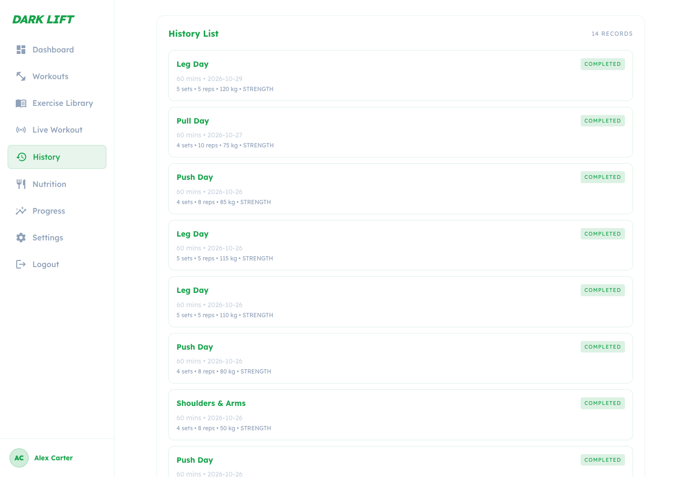
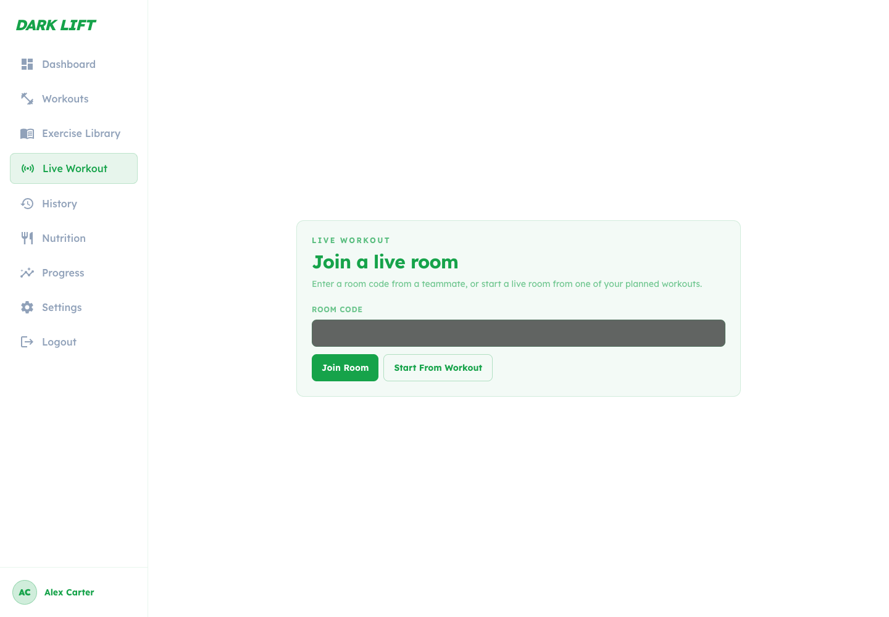
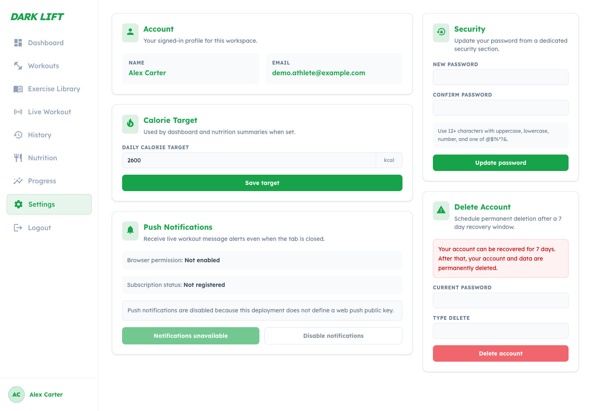

# Dark Lift – Frontend

Web client for **Dark Lift**, a fitness tracking app for planning workouts, logging live training sessions, tracking nutrition and following progress over time.

Built with Next.js (App Router), React 19 and Tailwind CSS. It talks to the [Dark Lift backend](https://github.com/Kamiwaza1/DarkLift-Backend) over a REST API and a STOMP/WebSocket connection for live workouts.



## Features

- **Dashboard** – daily calorie and protein rings, personalised workout recommendations, weekly training volume and calorie charts
- **Workout planner** – create, edit and schedule workouts with exercises, sets, reps and weights
- **Active workout session** – log sets as you train, with a built-in rest timer
- **Live workouts** – join a room with a code and train together with real-time chat over WebSockets
- **Exercise library** – browse exercises by muscle group
- **Workout history** – review every completed session
- **Nutrition diary** – log meals and macros against a daily calorie target
- **Progress insights** – volume per muscle group and workout length trends
- **Account** – registration, login, password reset and profile settings; httpOnly cookie auth with CSRF protection
- **Web push** – optional browser notifications

## Screenshots

| Login | Workouts |
| --- | --- |
|  |  |

| Nutrition | Progress |
| --- | --- |
|  |  |

| Exercise library | Workout history |
| --- | --- |
|  |  |

| Live workouts | Settings |
| --- | --- |
|  |  |

## Tech stack

| Area | Tools |
| --- | --- |
| Framework | Next.js 16, React 19 (React Compiler) |
| Styling | Tailwind CSS 4, shadcn/ui, Radix UI, Phosphor & Lucide icons |
| Charts | Recharts |
| Real time | STOMP over SockJS (`@stomp/stompjs`) |
| Testing | Cypress end-to-end tests |
| Tooling | ESLint, Docker, GitLab CI |

## Getting started

### Prerequisites

- Node.js 20+
- The Dark Lift backend running locally (default `http://localhost:8080`)

### Setup

```bash
git clone https://github.com/Kamiwaza1/fitnessappfrontend.git
cd fitnessappfrontend
npm install
cp .env.example .env.local
npm run dev
```

Open [http://localhost:3000](http://localhost:3000).

### Environment variables

| Variable | Description |
| --- | --- |
| `BACKEND_URL` | Backend base URL. Requests to `/api/*` are proxied here by `next.config.mjs`. Defaults to `http://localhost:8080`. |
| `NEXT_PUBLIC_API_BASE_URL` | Leave empty in local development so the same-origin `/api` proxy is used. |
| `NEXT_PUBLIC_WEB_PUSH_PUBLIC_KEY` | Optional VAPID public key. Leave empty to disable push notification signup. |

## Scripts

| Command | Description |
| --- | --- |
| `npm run dev` | Start the development server |
| `npm run build` | Create a production build |
| `npm start` | Serve the production build |
| `npm run lint` | Run ESLint |
| `npm run cy:open` | Open Cypress |
| `npm run e2e` | Start the app and run the Cypress suite headless |

## Docker

```bash
docker compose up --build
```

## Project structure

```
src/
├── app/          # Routes (dashboard, workouts, nutrition, progress, ...)
├── features/     # Feature modules: api, components, hooks, pages
├── shared/       # Shared API client, layout components, utilities
├── components/   # UI primitives
└── context/      # React context providers
cypress/          # End-to-end tests
docs/             # Design notes and UX report
```

## Testing

End-to-end tests live in `cypress/e2e` and cover authentication, navigation, dashboard, workouts, workout history, library, nutrition and settings. They run against a real backend, so start it first (see `cypress.config.js` for the test user settings).

## Documentation

- [UX design report](docs/ux-design-report.md)
- [Live workout messaging](docs/live-workout-messaging.md)
- [Password reset flow](docs/password-reset.md)

## Related repositories

- [DarkLift-Backend](https://github.com/Kamiwaza1/DarkLift-Backend) – Spring Boot API
- [fitness-mobile](https://github.com/Kamiwaza1/fitness-mobile) – React Native / Expo companion app
